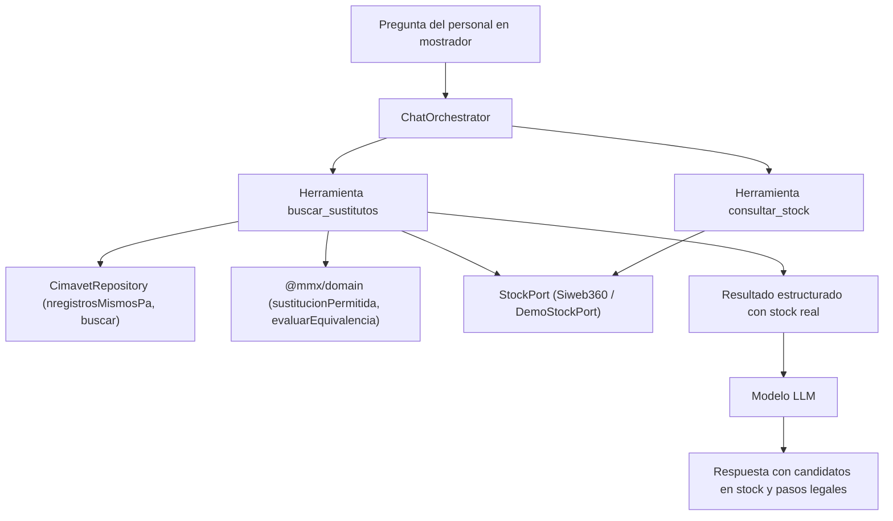

# Data Model: Asistente de sustitución y verificación de stock

**Feature**: `005-assistant-stock-substitutions`  
**Date**: 2026-11-06  
**Status**: Completed

## 1. Esquemas de Argumentos de Herramientas (`packages/shared`)

### `ArgsBuscarSustitutos`
Argumentos para la herramienta `buscar_sustitutos`.

```typescript
export const ArgsBuscarSustitutos = z.object({
  nombre: z.string().describe('Nombre del medicamento prescrito (ej. Prednicortone 5mg)').optional(),
  nregistro: z.string().describe('Número de registro del medicamento prescrito si se conoce').optional(),
  especie: z.string().describe('Especie animal de destino de la receta (ej. perro, gato)'),
  indicacion: z.string().describe('Indicación prescrita si se conoce').optional(),
});
```

### `ArgsConsultarStock`
Argumentos para la herramienta `consultar_stock`.

```typescript
export const ArgsConsultarStock = z.object({
  cns: z.array(z.string().regex(/^\d{6}$/)).describe('Lista de códigos nacionales de 6 dígitos a consultar'),
});

### `CriterioComparativaSustitucion`
Estructura de cada fila de la comparativa de sustitución en `ResultadoSimulacion.evidencias.comparativa`.

```typescript
export const CriterioComparativaSustitucion = z.object({
  criterio: z.string().describe('Denominación del criterio reglamentario evaluado'),
  prescrito: z.string().describe('Valor correspondiente al medicamento prescrito'),
  candidato: z.string().describe('Valor correspondiente al medicamento candidato'),
  coincide: z.boolean().describe('true si el criterio cumple con los requisitos normativos de equivalencia'),
  detalle: z.string().optional().describe('Aclaración técnica opcional o motivo de discrepancia'),
});
export type CriterioComparativaSustitucion = z.infer<typeof CriterioComparativaSustitucion>;

### `PeticionSobreescribirSustitucion`
Cuerpo de la petición para `POST /api/recetas/:id/lineas/:orden/sustituir-manual`.

```typescript
export const PeticionSobreescribirSustitucion = z.object({
  cn: z.string().regex(/^\d{6}$/).describe('Código nacional de la presentación elegida para sustituir'),
  nregistro: z.string().optional().describe('Número de registro de CIMAVet del medicamento'),
  motivo: z.string().min(5, 'El motivo de sustitución debe tener al menos 5 caracteres').describe('Justificación clínica u operativa del dispensador'),
});
export type PeticionSobreescribirSustitucion = z.infer<typeof PeticionSobreescribirSustitucion>;
```

### `PeticionCompararMedicamentos` y `RespuestaCompararMedicamentos`
Cuerpo de la petición y respuesta para `POST /api/medicamentos/comparar`.

```typescript
export const PeticionCompararMedicamentos = z.object({
  prescritoNregistro: z.string().min(1, 'El registro del medicamento prescrito es obligatorio'),
  candidatoNregistro: z.string().min(1, 'El registro del candidato es obligatorio'),
  especie: z.string().min(1, 'La especie es obligatoria'),
  indicacion: z.string().optional(),
});
export type PeticionCompararMedicamentos = z.infer<typeof PeticionCompararMedicamentos>;

export const RespuestaCompararMedicamentos = z.object({
  decision: z.enum(['EQUIVALENTE', 'NO_EQUIVALENTE', 'REQUIERE_REVISION']),
  motivos: z.array(z.string()),
  evidencias: z.object({
    comparativa: z.array(CriterioComparativaSustitucion),
    indicacion: z.string().optional(),
  }),
  reglaVersion: z.string(),
  esBloqueanteDuro: z.boolean(),
});
export type RespuestaCompararMedicamentos = z.infer<typeof RespuestaCompararMedicamentos>;
```
```
```

---

## 2. Modelos de Resultado de Herramientas

### `CandidatoEquivalente`
Estructura representativa de un medicamento equivalente autorizado con su disponibilidad en el establecimiento.

| Campo | Tipo | Descripción |
| :--- | :--- | :--- |
| `cn` | `string` | Código nacional de 6 dígitos de la presentación. |
| `nregistro` | `string` | Número de registro en CIMAVet. |
| `nombre` | `string` | Nombre comercial de la presentación. |
| `laboratorio` | `string \| null` | Laboratorio titular de la autorización. |
| `stockDisponible` | `number \| null` | Unidades físicas disponibles en el almacén «Farmacia». `null` si no hay stock o no se pudo consultar. |
| `tieneStock` | `boolean` | `true` si `stockDisponible > 0`. |

### `ResultadoBuscarSustitutos`
Payload devuelto al modelo de lenguaje al invocar `buscar_sustitutos`:

```typescript
export interface ResultadoBuscarSustitutos {
  fuenteId: string;
  version: string;
  prescrito: {
    nregistro: string;
    nombre: string;
    principiosActivos: string[];
    forma: string | null;
    concentracion: string | null;
    stockDisponible: number | null;
    tieneStock: boolean;
  };
  sustitucionPermitida: boolean;
  motivosBloqueo?: string[];
  requiereAclaracionIndicacion?: boolean;
  candidatosConStock: CandidatoEquivalente[];
  candidatosSinStock: CandidatoEquivalente[];
  obligacionesDispensador: string[];
  aviso?: string;
}
```

### `ResultadoConsultarStock`
Payload devuelto al modelo de lenguaje al invocar `consultar_stock`:

```typescript
export interface ResultadoConsultarStock {
  fuenteId: string;
  version: string;
  items: Array<{
    cn: string;
    stockDisponible: number;
    tieneStock: boolean;
    estado: 'OK' | 'NO_DISPONIBLE' | 'SIN_MAPEO';
  }>;
}
```

---

## 3. Relaciones y Flujo de Datos


