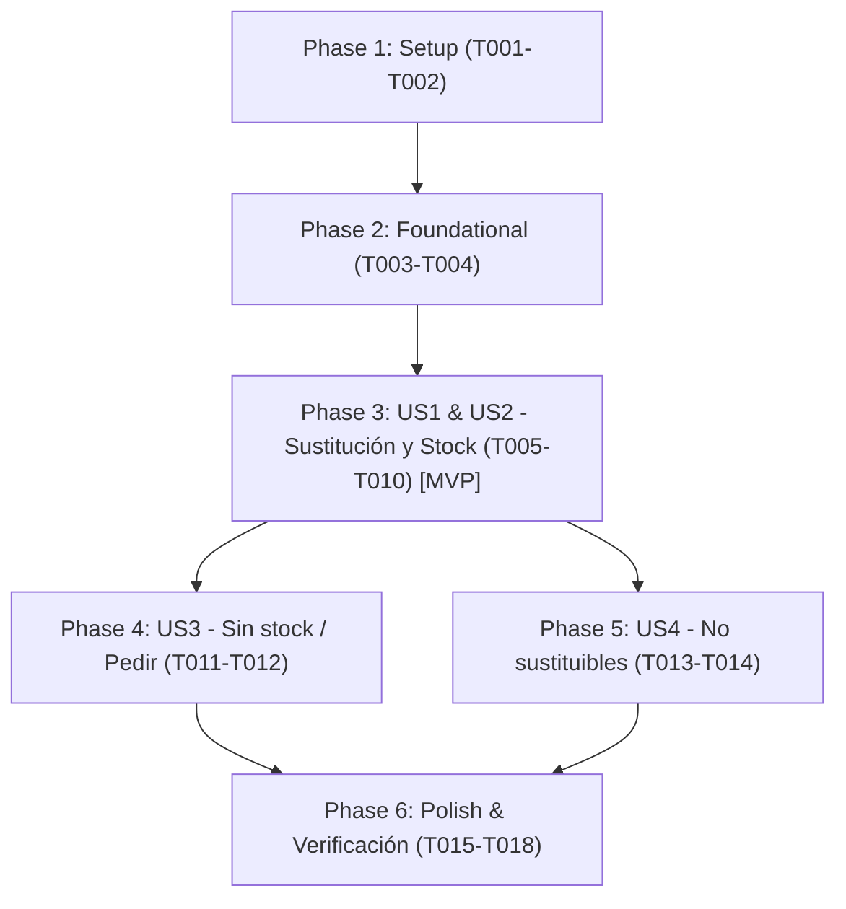

# Tasks: Asistente de sustitución de medicamentos con consulta de CIMAVet y stock en tiempo real

**Input**: Design documents from `/specs/005-assistant-stock-substitutions/` (`plan.md`, `spec.md`, `research.md`, `data-model.md`, `contracts/herramientas-sustitucion-stock.md`, `quickstart.md`)

**Prerequisites**: `plan.md`, `spec.md`, `data-model.md`, `contracts/`

**Organization**: Tasks are grouped by user story to enable independent implementation and testing of each story.

## Format: `[ID] [P?] [Story] Description`

- **[P]**: Can run in parallel (different files, no dependencies)
- **[Story]**: Which user story this task belongs to (e.g., US1, US2, US3, US4)
- Exact file paths included in all task descriptions

---

## Phase 1: Setup (Shared Infrastructure)

**Purpose**: Esquemas y definiciones compartidas en `@mmx/shared` y dependencias del asistente

- [X] T001 [P] Añadir esquemas de validación Zod `ArgsBuscarSustitutos` y `ArgsConsultarStock` en `packages/shared/src/schemas/asistente.ts`
- [X] T002 [P] Extender la interfaz `DepsHerramientas` en `packages/assistant/src/tools/contexto.ts` para admitir dependencia opcional de consulta de stock (`stock?: StockPort | null`)

---

## Phase 2: Foundational (Blocking Prerequisites)

**Purpose**: Actualización del rol del asistente en mostrador e inyección de dependencias en la API

**⚠️ CRITICAL**: Ninguna historia de usuario puede completarse hasta que el rol y la conexión de dependencias estén preparados

- [X] T003 Actualizar `INSTRUCCIONES` en `packages/assistant/src/instrucciones.ts` para fijar que el usuario es el personal del establecimiento dispensador (no el tutor del animal), prohibir advertencias de autoconsumo («consulte a su veterinario antes de cambiar el fármaco»), y guiar en el procedimiento legal de sustitución por falta de existencias (RD 1157/2021)
- [X] T004 Inyectar el puerto de stock `stock: d.stock` en la llamada a `crearHerramientas` dentro de `apps/api/src/crear-deps.ts`

**Checkpoint**: Base lista: el orquestador tiene acceso al contexto de stock y las instrucciones orientan al personal de mostrador.

---

## Phase 3: User Story 1 & 2 - Consulta de sustitución con candidatos y verificación de inventario (Priority: P1) 🎯 MVP

**Goal**: Permitir al personal consultar alternativas autorizadas ante falta de existencias de un medicamento prescrito (ej. Prednicortone 5 mg perro), consultando equivalencias en CIMAVet y existencias en Siweb360, presentando opciones con y sin stock y recordando las 3 obligaciones legales.

**Independent Test**: Ejecutar una consulta sobre un medicamento prescrito sin existencias (ej. Prednicortone 5 mg para perro). El asistente debe invocar `buscar_sustitutos`, devolver los equivalentes autorizados desglosados según disponibilidad en el almacén «Farmacia», y detallar los pasos legales (consentimiento tutor, comunicación prescriptor y receta apartada para garante en modo POST), sin dirigirse al usuario como tutor del animal.

### Tests for User Story 1 & 2

- [X] T005 [P] [US1] Crear suite de pruebas unitarias para `buscar_sustitutos` y `consultar_stock` en `packages/assistant/test/tools-sustitucion.test.ts`
- [X] T006 [P] [US1] Añadir test de integración en `packages/assistant/test/orchestrator.test.ts` para la consulta de sustitución de Prednicortone 5 mg perro validando el rol de personal dispensador y la presentación de stock

### Implementation for User Story 1 & 2

- [X] T007 [P] [US2] Implementar la herramienta de solo lectura `consultar_stock` en `packages/assistant/src/tools/stock.ts`
- [X] T008 [US1] Implementar la herramienta de solo lectura `buscar_sustitutos` en `packages/assistant/src/tools/sustitucion.ts` integrando `cimavet.nregistrosMismosPa`, `evaluarEquivalencia` de `@mmx/domain`, y consulta de stock disponible en `StockPort`
- [X] T009 [US1] Registrar `buscar_sustitutos` y `consultar_stock` en `packages/assistant/src/tools/index.ts` y exportarlas en `packages/assistant/src/index.ts`
- [X] T010 [US1] Integrar la ejecución en `packages/assistant/src/orchestrator.ts` asegurando que las fuentes y citas de sustitución y stock se computen correctamente

**Checkpoint**: MVP operativo. El asistente responde a consultas de sustitución por falta de existencias con datos de stock reales de la farmacia.

---

## Phase 4: User Story 3 - Casos sin stock o sin candidatos autorizados (Priority: P2)

**Goal**: Orientar adecuadamente al empleado cuando todos los medicamentos equivalentes autorizados tienen stock cero o cuando no existe ningún equivalente en CIMAVet para esa especie y principio activo.

**Independent Test**: Consultar por un medicamento cuyos equivalentes autorizados tienen 0 unidades en inventario. El asistente debe clasificarlos como «Sin stock en almacén» y recomendar generar pedido al distribuidor (`PEDIR`), o indicar la necesidad de nueva prescripción si no hay ningún equivalente en el catálogo.

### Implementation for User Story 3

- [X] T011 [US3] Añadir casos de prueba en `packages/assistant/test/tools-sustitucion.test.ts` para candidatos con stock cero y para fármacos sin equivalentes autorizados
- [X] T012 [US3] Refinar el formateo de respuesta en `packages/assistant/src/tools/sustitucion.ts` y las directrices en `packages/assistant/src/instrucciones.ts` para orientar a la tramitación de pedido (`PEDIR`) ante falta global de stock

**Checkpoint**: Respuestas robustas y sin alucinaciones cuando no hay existencias de ningún sustituto en tienda.

---

## Phase 5: User Story 4 - Bloqueo normativo de medicamentos no sustituibles (Priority: P2)

**Goal**: Garantizar que el asistente deniegue de manera determinista la sustitución de medicamentos biológicos, inmunológicos o excluidos por normativa sanitaria (RD 1157/2021).

**Independent Test**: Consultar por la sustitución de una vacuna o medicamento inmunológico. El asistente debe responder que la sustitución está legalmente excluida por normativa y recomendar `PEDIR`.

### Implementation for User Story 4

- [X] T013 [US4] Añadir casos de prueba en `packages/assistant/test/tools-sustitucion.test.ts` con medicamentos biológicos e inmunológicos
- [X] T014 [US4] Integrar la verificación determinista `sustitucionPermitida` de `@mmx/domain` al inicio de `buscar_sustitutos` en `packages/assistant/src/tools/sustitucion.ts` para devolver de inmediato el bloqueo legal y sus motivos sin evaluar equivalencias

**Checkpoint**: Protección sanitaria y legal completa contra sustituciones indebidas.

---

## Phase 6: Polish & Cross-Cutting Concerns

**Purpose**: Validación integral, linters, pruebas de tipos y escenarios de quickstart

- [X] T015 [P] Actualizar la documentación y contratos en `specs/005-assistant-stock-substitutions/contracts/herramientas-sustitucion-stock.md` con los detalles finales
- [X] T016 Ejecutar los tests unitarios y de integración: `pnpm --filter @mmx/assistant test`
- [X] T017 Ejecutar la verificación completa de calidad: `pnpm lint && pnpm typecheck && pnpm test`
- [X] T018 Validar los escenarios de prueba descritos en `specs/005-assistant-stock-substitutions/quickstart.md`

---

## Dependencies & Execution Order

### Phase Dependencies

- **Setup (Phase 1)**: Sin dependencias, inicia inmediatamente.
- **Foundational (Phase 2)**: Depende de Phase 1. Bloquea las historias de usuario.
- **User Story 1 & 2 (Phase 3 - MVP)**: Depende de Phase 2. Entrega el flujo principal de sustitución con stock.
- **User Story 3 (Phase 4)**: Depende de Phase 3. Maneja casos de desabastecimiento total.
- **User Story 4 (Phase 5)**: Depende de Phase 3. Aplica bloqueos deterministas de no sustituibles.
- **Polish (Phase 6)**: Depende de haber completado las fases anteriores.

### User Story Dependencies

### Parallel Opportunities

- `T001` y `T002` se pueden ejecutar en paralelo (archivos independientes).
- `T005`, `T006` y `T007` se pueden escribir en paralelo una vez completada la fase Foundational.
- `US3` y `US4` pueden implementarse en paralelo tras completar el MVP (`US1 & US2`).

---

## Implementation Strategy

### MVP First (User Story 1 & 2)
1. Completar Setup (`T001`-`T002`) y Foundational (`T003`-`T004`).
2. Implementar herramientas `buscar_sustitutos` y `consultar_stock` con tests (`T005`-`T010`).
3. **Validar MVP**: Probar consulta de Prednicortone 5 mg y verificar respuesta en mostrador.

### Incremental Delivery
1. Añadir gestión de desabastecimiento total y no sustituibles (`T011`-`T014`).
2. Pasar linter, typecheck y suite completa de tests (`T015`-`T018`).
