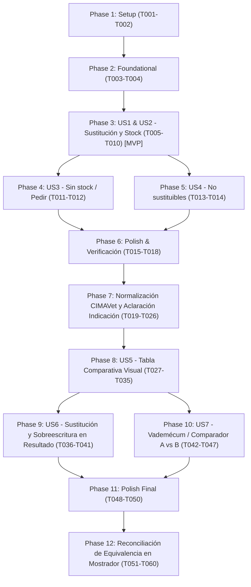

# Tasks: Asistente de sustitución de medicamentos con consulta de CIMAVet y stock en tiempo real

**Input**: Design documents from `/specs/005-assistant-stock-substitutions/` (`plan.md`, `spec.md`, `research.md`, `data-model.md`, `contracts/herramientas-sustitucion-stock.md`, `quickstart.md`)

**Prerequisites**: `plan.md`, `spec.md`, `data-model.md`, `contracts/`

**Organization**: Tasks are grouped by user story to enable independent implementation and testing of each story.

## Format: `[ID] [P?] [Story] Description`

- **[P]**: Can run in parallel (different files, no dependencies)
- **[Story]**: Which user story this task belongs to (e.g., US1, US2, US3, US4)
- Exact file paths included in all task descriptions

---

## Phase 1: Setup (Shared Infrastructure)

**Purpose**: Esquemas y definiciones compartidas en `@mmx/shared` y dependencias del asistente

- [X] T001 [P] Añadir esquemas de validación Zod `ArgsBuscarSustitutos` y `ArgsConsultarStock` en `packages/shared/src/schemas/asistente.ts`
- [X] T002 [P] Extender la interfaz `DepsHerramientas` en `packages/assistant/src/tools/contexto.ts` para admitir dependencia opcional de consulta de stock (`stock?: StockPort | null`)

---

## Phase 2: Foundational (Blocking Prerequisites)

**Purpose**: Actualización del rol del asistente en mostrador e inyección de dependencias en la API

**⚠️ CRITICAL**: Ninguna historia de usuario puede completarse hasta que el rol y la conexión de dependencias estén preparados

- [X] T003 Actualizar `INSTRUCCIONES` en `packages/assistant/src/instrucciones.ts` para fijar que el usuario es el personal del establecimiento dispensador (no el tutor del animal), prohibir advertencias de autoconsumo («consulte a su veterinario antes de cambiar el fármaco»), y guiar en el procedimiento legal de sustitución por falta de existencias (RD 1157/2021)
- [X] T004 Inyectar el puerto de stock `stock: d.stock` en la llamada a `crearHerramientas` dentro de `apps/api/src/crear-deps.ts`

**Checkpoint**: Base lista: el orquestador tiene acceso al contexto de stock y las instrucciones orientan al personal de mostrador.

---

## Phase 3: User Story 1 & 2 - Consulta de sustitución con candidatos y verificación de inventario (Priority: P1) 🎯 MVP

**Goal**: Permitir al personal consultar alternativas autorizadas ante falta de existencias de un medicamento prescrito (ej. Prednicortone 5 mg perro), consultando equivalencias en CIMAVet y existencias en Siweb360, presentando opciones con y sin stock y recordando las 3 obligaciones legales.

**Independent Test**: Ejecutar una consulta sobre un medicamento prescrito sin existencias (ej. Prednicortone 5 mg para perro). El asistente debe invocar `buscar_sustitutos`, devolver los equivalentes autorizados desglosados según disponibilidad en el almacén «Farmacia», y detallar los pasos legales (consentimiento tutor, comunicación prescriptor y receta apartada para garante en modo POST), sin dirigirse al usuario como tutor del animal.

### Tests for User Story 1 & 2

- [X] T005 [P] [US1] Crear suite de pruebas unitarias para `buscar_sustitutos` y `consultar_stock` en `packages/assistant/test/tools-sustitucion.test.ts`
- [X] T006 [P] [US1] Añadir test de integración en `packages/assistant/test/orchestrator.test.ts` para la consulta de sustitución de Prednicortone 5 mg perro validando el rol de personal dispensador y la presentación de stock

### Implementation for User Story 1 & 2

- [X] T007 [P] [US2] Implementar la herramienta de solo lectura `consultar_stock` en `packages/assistant/src/tools/stock.ts`
- [X] T008 [US1] Implementar la herramienta de solo lectura `buscar_sustitutos` en `packages/assistant/src/tools/sustitucion.ts` integrando `cimavet.nregistrosMismosPa`, `evaluarEquivalencia` de `@mmx/domain`, y consulta de stock disponible en `StockPort`
- [X] T009 [US1] Registrar `buscar_sustitutos` y `consultar_stock` en `packages/assistant/src/tools/index.ts` y exportarlas en `packages/assistant/src/index.ts`
- [X] T010 [US1] Integrar la ejecución en `packages/assistant/src/orchestrator.ts` asegurando que las fuentes y citas de sustitución y stock se computen correctamente

**Checkpoint**: MVP operativo. El asistente responde a consultas de sustitución por falta de existencias con datos de stock reales de la farmacia.

---

## Phase 4: User Story 3 - Casos sin stock o sin candidatos autorizados (Priority: P2)

**Goal**: Orientar adecuadamente al empleado cuando todos los medicamentos equivalentes autorizados tienen stock cero o cuando no existe ningún equivalente en CIMAVet para esa especie y principio activo.

**Independent Test**: Consultar por un medicamento cuyos equivalentes autorizados tienen 0 unidades en inventario. El asistente debe clasificarlos como «Sin stock en almacén» y recomendar generar pedido al distribuidor (`PEDIR`), o indicar la necesidad de nueva prescripción si no hay ningún equivalente en el catálogo.

### Implementation for User Story 3

- [X] T011 [US3] Añadir casos de prueba en `packages/assistant/test/tools-sustitucion.test.ts` para candidatos con stock cero y para fármacos sin equivalentes autorizados
- [X] T012 [US3] Refinar el formateo de respuesta en `packages/assistant/src/tools/sustitucion.ts` y las directrices en `packages/assistant/src/instrucciones.ts` para orientar a la tramitación de pedido (`PEDIR`) ante falta global de stock

**Checkpoint**: Respuestas robustas y sin alucinaciones cuando no hay existencias de ningún sustituto en tienda.

---

## Phase 5: User Story 4 - Bloqueo normativo de medicamentos no sustituibles (Priority: P2)

**Goal**: Garantizar que el asistente deniegue de manera determinista la sustitución de medicamentos biológicos, inmunológicos o excluidos por normativa sanitaria (RD 1157/2021).

**Independent Test**: Consultar por la sustitución de una vacuna o medicamento inmunológico. El asistente debe responder que la sustitución está legalmente excluida por normativa y recomendar `PEDIR`.

### Implementation for User Story 4

- [X] T013 [US4] Añadir casos de prueba en `packages/assistant/test/tools-sustitucion.test.ts` con medicamentos biológicos e inmunológicos
- [X] T014 [US4] Integrar la verificación determinista `sustitucionPermitida` de `@mmx/domain` al inicio de `buscar_sustitutos` en `packages/assistant/src/tools/sustitucion.ts` para devolver de inmediato el bloqueo legal y sus motivos sin evaluar equivalencias

**Checkpoint**: Protección sanitaria y legal completa contra sustituciones indebidas.

---

## Phase 6: Polish & Cross-Cutting Concerns

**Purpose**: Validación integral, linters, pruebas de tipos y escenarios de quickstart

- [X] T015 [P] Actualizar la documentación y contratos en `specs/005-assistant-stock-substitutions/contracts/herramientas-sustitucion-stock.md` con los detalles finales
- [X] T016 Ejecutar los tests unitarios y de integración: `pnpm --filter @mmx/assistant test`
- [X] T017 Ejecutar la verificación completa de calidad: `pnpm lint && pnpm typecheck && pnpm test`
- [X] T018 Validar los escenarios de prueba descritos en `specs/005-assistant-stock-substitutions/quickstart.md`

---

## Phase 7: Normalización Canónica CIMAVet y Aclaración de Indicación (FR-013, FR-014, FR-015)

**Purpose**: Resolver las discrepancias de IDs de CIMAVet (eliminando falsos negativos por IDs negativos como `-29`), armonizar códigos de vía e incorporar la solicitud de aclaración de patología en sustitución de mostrador.

**Independent Test**: Ejecutar una consulta de sustitución para «HEDYLON 5 MG 30 COMP para un perro». El sistema debe resolver la especie canónica «Perros» (`id: 14`), identificar a **Prednicortone 5 mg 30 comprimidos** como sustituto válido con 7 unidades en stock en Siweb360, y solicitar al profesional la aclaración de la indicación prescrita para completar la evaluación de equivalencia reglamentaria (Escenario 4 de `quickstart.md`).

### Tests for Phase 7

- [X] T019 [P] [US1] Añadir pruebas unitarias en `packages/cimavet/test/client.test.ts` y `packages/cimavet/test/nomenclator-jobs.test.ts` para `especiePorTexto` verificando el descarte de IDs sintéticos o negativos (`id <= 0`) ante registros duplicados
- [X] T020 [P] [US1] Añadir test unitario en `packages/assistant/test/tools-sustitucion.test.ts` que simule la búsqueda de sustitutos de Hedylon 5 mg con Prednicortone 5 mg verificando que no se bloquea por especie ni vía y activa `requiereAclaracionIndicacion`

### Implementation for Phase 7

- [X] T021 [US1] Modificar `especiePorTexto` en `packages/cimavet/src/repo.ts` y en `apps/api/src/servicios/medicamentos.ts` para filtrar estrictamente `cimavetMaestra.id > 0` y ordenar por `id asc` para seleccionar el ID canónico positivo (`14` para «Perros») (FR-013)
- [X] T022 [US1] Reconciliar y asegurar correspondencia de vías de administración en `packages/cimavet/src/normalizar.ts` y `packages/cimavet/src/repo.ts` entre los códigos de Nomenclátor XML (`cod_via_admin`) y la API REST (`viasAdministracion.codigo` / `id`) (FR-014)
- [X] T023 [US1] Actualizar `buscar_sustitutos` en `packages/assistant/src/tools/sustitucion.ts` y `simulaciones-medicamento.ts` para emitir `requiereAclaracionIndicacion: true` cuando la consulta no aporte indicación clínica expresa y asegurar que `simular_equivalencia` use la especie canónica resuelta (FR-015)
- [X] T024 [US1] Actualizar `INSTRUCCIONES` en `packages/assistant/src/instrucciones.ts` para orientar al modelo a solicitar aclaración de la indicación prescrita al dispensador antes de confirmar la sustitución definitiva
- [X] T025 [P] Ejecutar la suite completa de linters, chequeo de tipos y pruebas automatizadas: `pnpm lint && pnpm typecheck && pnpm test`
- [X] T026 Validar de extremo a extremo el Escenario 4 de `specs/005-assistant-stock-substitutions/quickstart.md` (Hedylon 5 mg vs Prednicortone 5 mg con stock)

**Checkpoint**: Consulta de Hedylon 5 mg para perro propone Prednicortone 5 mg con stock en mostrador y solicita la aclaración de indicación sin falsos negativos de especie o vía.

---

## Phase 8: User Story 5 - Tabla comparativa visual de criterios de sustitución (FR-016)

**Purpose**: Estructurar la comparativa criterio a criterio en el motor de dominio y renderizarla de manera accesible en la tarjeta de simulación de la interfaz web para dar máxima transparencia al profesional sobre el porqué de la equivalencia o discrepancia técnica.

**Independent Test**: Consultar al asistente comparando dos medicamentos (ej. Hedylon 5 mg frente a Prednicortone 5 mg). La simulación de equivalencia debe incluir en `evidencias.comparativa` el desglose de los 7 criterios normativos con nombres legibles y la tarjeta de simulación en la interfaz web debe mostrar la tabla comparativa visual con badges de cumplimiento (✓ / ✗).

### Tests for Phase 8

- [X] T027 [P] [US5] Añadir tipo y esquema Zod `CriterioComparativaSustitucion` en `packages/shared/src/schemas/asistente.ts`
- [X] T028 [P] [US5] Añadir pruebas unitarias en `packages/domain/test/simulacion.test.ts` para verificar la generación de `evidencias.comparativa` en `simularEquivalencia` (7 criterios, casos de equivalencia y casos con discrepancias)
- [X] T031 [P] [US5] Añadir test en `packages/assistant/test/tools-sustitucion.test.ts` verificando que `simular_equivalencia` genera la comparativa con nombres legibles para humanos resueltos vía `d.cimavet.nombresFicha`
- [X] T033 [P] [US5] Añadir test de componente en `apps/web/src/componentes/asistente.test.tsx` verificando el renderizado accesible de la tabla comparativa en `TarjetaSimulacion`

### Implementation for Phase 8

- [X] T029 [US5] Implementar la generación determinista de `comparativa: CriterioComparativaSustitucion[]` en `simularEquivalencia` dentro de `packages/domain/src/simulacion.ts`, admitiendo etiquetas legibles opcionales para formas, vías y especies
- [X] T030 [US5] Actualizar `herramientaSimularEquivalencia` en `packages/assistant/src/tools/simulaciones-medicamento.ts` para resolver de forma asíncrona los nombres legibles de forma, vías y especies vía `d.cimavet.nombresFicha` y suministrarlos a `simularEquivalencia`
- [X] T032 [US5] Implementar la tabla comparativa de criterios en `TarjetaSimulacion` de `apps/web/src/componentes/asistente.tsx`, mostrando columnas *Criterio*, *Prescrito*, *Candidato* y *Estado* con badges de coincidencia (✓ verde) y discrepancia (✗ rojo)
- [X] T034 [US5] Ejecutar la suite completa de calidad: `pnpm lint && pnpm typecheck && pnpm test`
- [X] T035 Validar de extremo a extremo el Escenario 5 de `specs/005-assistant-stock-substitutions/quickstart.md` (comparativa visual entre Hedylon 5 mg y Prednicortone 5 mg)

**Checkpoint**: Tabla comparativa visible, accesible y completamente integrada desde el motor hasta la interfaz web.

---

## Phase 9: User Story 6 - Selección interactiva de sustituto y sobreescritura en pantalla de Resultado (Priority: P1) (FR-017)

**Goal**: En la pantalla de resultado de dispensación (`ResultadoReceta`), cuando un medicamento prescrito carece de existencias o tiene decisión `PEDIR` (ej. Bioclanic 50/12,5 mg felino), permitir buscar y seleccionar interactivamente un producto alternativo (ej. Clavusan 50/12,5 mg), evaluar la equivalencia en tiempo real mostrando la tabla comparativa de criterios de los 7 campos normativos, y habilitar la acción de sobreescribir la dispensación requiriendo obligatoriamente la razón escrita por el dispensador (sin requerir confirmación del garante en pantalla, operando bajo modo POST de RD 1157/2021 donde la receta física se aparta en bandeja para firma posterior), siempre que no constituya un `BLOQUEANTE_DURO`.

**Independent Test**: Cargar una receta con Bioclanic 50/12,5 mg en estado PEDIR. Seleccionar Clavusan 50/12,5 mg desde el buscador de sustitutos en la pantalla de resultado; el sistema debe mostrar la comparativa de criterios y permitir sobreescribir indicando la razón obligatoria para proceder a la dispensación.

### Tests for User Story 6

- [X] T036 [P] [US6] Añadir esquema Zod `PeticionSobreescribirSustitucion` en `packages/shared/src/schemas/receta.ts`
- [X] T037 [P] [US6] Añadir tests unitarios y de integración para `POST /api/recetas/:id/lineas/:orden/sustituir-manual` en `apps/api/test/rutas-recetas-sustitucion.test.ts` (casos: sustitución exitosa con motivo, rechazo por motivo menor a 5 caracteres, rechazo por `BLOQUEANTE_DURO` [inmunológico/biológico/cascada] y registro en `audit_event` con tipo `SUSTITUCION_SOBREESCRITA`)
- [X] T038 [P] [US6] Añadir tests de componente en `apps/web/src/paginas/resultado.test.tsx` para el buscador interactivo de sustitutos, renderizado de la tabla comparativa y modal de confirmación con motivo obligatorio

### Implementation for User Story 6

- [X] T039 [US6] Implementar endpoint `POST /api/recetas/:id/lineas/:orden/sustituir-manual` en `apps/api/src/rutas/recetas.ts`, validando que no incurra en `BLOQUEANTE_DURO`, actualizando la línea con el producto sustituto, registrando en `audit_event` el evento inmutable `SUSTITUCION_SOBREESCRITA` y habilitando el paso a dispensación
- [X] T040 [US6] Implementar en `apps/web/src/paginas/resultado.tsx` la búsqueda interactiva de candidatos (vía `/api/medicamentos/buscar` y stock), la evaluación en vivo mostrando la tabla comparativa de los 7 criterios normativos, y el diálogo con motivo obligatorio para sobreescribir
- [X] T041 [US6] Conectar en `apps/web/src/paginas/resultado.tsx` la acción de sobreescritura con `POST /api/recetas/:id/lineas/:orden/sustituir-manual` para actualizar el estado de la receta y desbloquear la dispensación

**Checkpoint**: En `ResultadoReceta`, una línea con falta de stock permite buscar Clavusan 50/12,5 mg, evaluar su equivalencia visual y sobreescribir con motivo para dispensar de inmediato.

---

## Phase 10: User Story 7 - Sección dedicada de consulta y comparador de sustitución en Vademécum (Priority: P2) (FR-018)

**Goal**: Proveer una página dedicada e independiente accesible desde el menú principal (`/vademecum`) que permita al personal seleccionar dos medicamentos de CIMAVet (referencia A y candidato B) y evaluar su equivalencia técnica mediante el motor de sustitución, presentando la tabla comparativa de los 7 criterios normativos con sus distintivos de cumplimiento y conclusión reglamentaria.

**Independent Test**: Navegar a `/vademecum` desde el menú principal, seleccionar dos medicamentos (ej. Bioclanic 50/12,5 mg y Clavusan 50/12,5 mg) con especie felina, y verificar que se llama a `POST /api/medicamentos/comparar` y se renderiza la tabla comparativa completa con la conclusión de sustituibilidad.

### Tests for User Story 7

- [X] T042 [P] [US7] Añadir esquemas Zod `PeticionCompararMedicamentos` y `RespuestaCompararMedicamentos` en `packages/shared/src/schemas/asistente.ts`
- [X] T043 [P] [US7] Añadir tests para el endpoint `POST /api/medicamentos/comparar` en `apps/api/test/rutas-medicamentos-comparar.test.ts`
- [X] T044 [P] [US7] Añadir tests de componente para la página `Vademecum` en `apps/web/src/paginas/vademecum.test.tsx`

### Implementation for User Story 7

- [X] T045 [US7] Implementar el endpoint `POST /api/medicamentos/comparar` en `apps/api/src/rutas/medicamentos.ts`, cargando ambas fichas de CIMAVet, resolviendo nombres legibles, ejecutando `simularEquivalencia` en `@mmx/domain` y devolviendo comparativa de 7 criterios y conclusión
- [X] T046 [US7] Implementar la página `Vademecum` en `apps/web/src/paginas/vademecum.tsx` con autocompletado para fármacos A y B, selectores de especie e indicación opcional, invocación a `/api/medicamentos/comparar` y renderizado de la tabla comparativa
- [X] T047 [US7] Registrar la ruta `/vademecum` en `apps/web/src/main.tsx` y añadir el enlace «Vademécum» en la barra de navegación `NAV` de `apps/web/src/componentes/layout.tsx`

**Checkpoint**: Página `/vademecum` operativa en la navegación para contrastar cualquier fármaco A frente a B y mostrar la conclusión y tabla de criterios.

---

## Phase 11: Polish & Cross-Cutting Concerns (Final)

**Purpose**: Verificación de contratos, linters, pruebas de tipos y validación de escenarios de quickstart

- [X] T048 [P] Actualizar la documentación y contratos en `specs/005-assistant-stock-substitutions/contracts/api-sustitucion-vademecum.md`
- [X] T049 Ejecutar la verificación completa de calidad: `pnpm lint && pnpm typecheck && pnpm test`
- [X] T050 Validar de extremo a extremo los Escenarios 6 y 7 de `specs/005-assistant-stock-substitutions/quickstart.md`

---

## Phase 12: Reconciliación de Equivalencia en Mostrador (FR-019, FR-020, FR-021)

**Goal**: Resolver los falsos negativos observados en la sustitución en mostrador (caso Bioclanic vs Clavusan 50/12,5 mg): reconciliar vías de administración canónicas evitando colisiones de IDs entre Nomenclátor XML y la API REST de CIMAVet (FR-019), admitir la coincidencia de dosis por denominación nominal autorizada ante variaciones en la formulación de sales/diluyentes galénicos (FR-020), y tratar indicaciones no especificadas o genéricas como avisos informativos no bloqueantes (FR-021).

**Independent Test**: Comparar `BIOCLANIC 50 mg + 12,5 mg` (`4332 ESP`) frente a `CLAVUSAN 50 mg + 12,5 mg` (`4161 ESP`) en `/vademecum` o vía `POST /api/medicamentos/comparar` para perros o gatos sin indicación clínica específica. El sistema debe evaluar `VÍA ORAL` coincidente para ambos (✓), concentración coincidente basada en el nombre nominal `50 mg + 12,5 mg` (✓), indicación con aviso informativo de comprobación, y conclusión reglamentaria `EQUIVALENTE` (Escenario 8 de `quickstart.md`).

### Tests & Implementation for Phase 12

- [X] T051 [P] [US7] Añadir tests unitarios en `packages/cimavet/test/client.test.ts` y `packages/cimavet/test/nomenclator-jobs.test.ts` para verificar la armonización canónica de vías (`id: 48` → clave `54` VÍA ORAL, `id: 54` → clave `59` VÍA RECTAL) en normalización y `upsertMaestras` (FR-019)
- [X] T052 [US7] Implementar la armonización canónica de vías en `packages/cimavet/src/normalizar.ts` y `packages/cimavet/src/repo.ts` garantizando que las vías orales y rectales usen los códigos del Nomenclátor (`54` y `59`) tanto al normalizar medicamentos de la API REST como al guardar diccionarios en `cimavet_maestra` (FR-019)
- [X] T053 [P] [US7] Añadir tests unitarios en `packages/domain/test/equivalencia.test.ts` para reconciliación de concentración por nombre nominal (`concentracionDelNombre`) evaluando Bioclanic vs Clavusan 50/12,5 mg y verificando que no se marca `CONCENTRACION_DISTINTA` (FR-020)
- [X] T054 [US7] Implementar en `packages/domain/src/equivalencia.ts` y `packages/domain/src/simulacion.ts` el fallback a `concentracionDelNombre` cuando las cantidades brutas de sal difieran pero la dosis nominal autorizada coincida, reflejándolo en la comparativa de criterios (FR-020)
- [X] T055 [P] [US7] Añadir tests unitarios en `packages/domain/test/equivalencia.test.ts` y `packages/domain/test/simulacion.test.ts` verificando que una indicación clínica ausente, nula o genérica ("Tratamiento prescrito") genera estado `aviso` en la comparativa sin bloquear la equivalencia técnica (FR-021)
- [X] T056 [US7] Implementar en `packages/domain/src/equivalencia.ts`, `packages/domain/src/indicacion.ts` y `packages/domain/src/simulacion.ts` el tratamiento no bloqueante de indicación clínica no especificada o genérica, emitiendo estado `aviso` en lugar de `INDICACION_NO_COINCIDE` (FR-021)
- [X] T057 [P] [US7] Añadir test de integración en `apps/api/test/rutas-medicamentos-comparar.test.ts` comparando Bioclanic (`4332 ESP`) y Clavusan (`4161 ESP`) y verificando respuesta `decision: 'EQUIVALENTE'` con vía oral coincidente y fila de indicación con estado `aviso`
- [X] T058 [US7] Actualizar los componentes visuales de la tabla comparativa en `apps/web/src/componentes/asistente.tsx`, `apps/web/src/paginas/vademecum.tsx` y `apps/web/src/paginas/resultado.tsx` para renderizar el distintivo de estado `aviso` en ámbar sin penalizar la conclusión general
- [X] T059 Ejecutar la verificación completa de calidad: `pnpm lint && pnpm typecheck && pnpm test`
- [X] T060 Validar el Escenario 8 de `specs/005-assistant-stock-substitutions/quickstart.md` comprobando la equivalencia de Bioclanic vs Clavusan 50/12,5 mg en el navegador o mediante tests

---

## Dependencies & Execution Order

### Phase Dependencies

- **Setup (Phase 1)**: Sin dependencias, inicia inmediatamente.
- **Foundational (Phase 2)**: Depende de Phase 1. Bloquea las historias de usuario.
- **User Story 1 & 2 (Phase 3 - MVP)**: Depende de Phase 2. Entrega el flujo principal de sustitución con stock.
- **User Story 3 (Phase 4)**: Depende de Phase 3. Maneja casos de desabastecimiento total.
- **User Story 4 (Phase 5)**: Depende de Phase 3. Aplica bloqueos deterministas de no sustituibles.
- **Polish (Phase 6)**: Validación inicial de la base de herramientas.
- **Normalización y Aclaración (Phase 7)**: Depende de Phase 6. Corrige falsos negativos de CIMAVet (FR-013, FR-014) y añade la solicitud interactiva de indicación prescrita (FR-015).
- **Tabla Comparativa de Criterios (Phase 8)**: Depende de Phase 7. Incorpora `evidencias.comparativa` en dominio, enriquecimiento en el asistente y tabla visual en la UI web (FR-016).
- **Sustitución Interactiva y Sobreescritura (Phase 9 - US6)**: Depende de Phase 8 (reutiliza motor de equivalencia y tabla comparativa de criterios).
- **Sección Vademécum / Comparador (Phase 10 - US7)**: Depende de Phase 8 (reutiliza `simularEquivalencia` y componentes de tabla comparativa). Puede desarrollarse en paralelo con Phase 9.
- **Polish (Phase 11)**: Depende de Phase 9 y Phase 10.
- **Reconciliación de Equivalencia en Mostrador (Phase 12)**: Depende de Phase 11. Corrige la armonización canónica de vías (FR-019), la reconciliación de concentraciones por nombre nominal (FR-020) y el manejo de indicación clínica ausente como aviso no bloqueante (FR-021).

### User Story Dependencies

### Parallel Opportunities

- En Phase 12, los tests `T051` (CIMAVet vías), `T053` (Dominio concentración), `T055` (Dominio indicación) y `T057` (API comparar) pueden prepararse en paralelo al residir en paquetes y archivos desacoplados.
- Las implementaciones `T052` (CIMAVet), `T054` (Dominio concentración) y `T056` (Dominio indicación) pueden ejecutarse en paralelo antes de la integración visual en UI (`T058`).

---

## Implementation Strategy

### MVP First (User Story 1 & 2)
1. Completar Setup (`T001`-`T002`) y Foundational (`T003`-`T004`).
2. Implementar herramientas `buscar_sustitutos` y `consultar_stock` con tests (`T005`-`T010`).
3. **Validar MVP**: Probar consulta de Prednicortone 5 mg y verificar respuesta en mostrador.

### Incremental Delivery & Robustez Regulatoria
1. Añadir gestión de desabastecimiento total y no sustituibles (`T011`-`T014`).
2. Pasar linter, typecheck y suite completa de tests (`T015`-`T018`).
3. Aplicar normalización estricta de CIMAVet (`id > 0`, vías unificadas) y flujo de aclaración interactiva de indicación clínica (`T019`-`T026`).
4. Añadir tabla comparativa de criterios de sustitución en motor, orquestador y componente de interfaz web (`T027`-`T035`).
5. Añadir selección interactiva y sobreescritura con motivo obligatorio en pantalla de resultado (`T036`-`T041`, US6).
6. Añadir página de consulta y comparador libre en `/vademecum` (`T042`-`T047`, US7).
7. Verificación de calidad, linters, tests y quickstart (`T048`-`T050`).
8. Implementar reconciliación de equivalencia para mostrador: vías canónicas (FR-019), concentración nominal (FR-020) e indicación no especificada como aviso (FR-021) (`T051`-`T060`).
