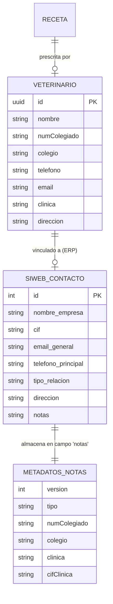

# Data Model: Sincronización de contactos de SiWeb y metadatos veterinarios

**Feature**: `006-siweb-vet-clinic-sync` | **Date**: 2026-11-06

---

## 1. Esquema de metadatos estructurados en `notas` de SiWeb

Los atributos específicos de la prescripción veterinaria que no disponen de columna nativa en SiWeb se empaquetan en un bloque delimitado dentro del campo de texto libre `notas`:

```text
Observaciones comerciales previas del contacto...

---PRESVET---
{
  "version": 1,
  "tipo": "veterinario",
  "numColegiado": "28/1234",
  "colegio": "Madrid",
  "clinica": "Centro Veterinario Guadarrama",
  "cifClinica": "B12345678"
}
```

### Esquema Zod (`packages/shared/src/schemas/contactos-siweb.ts`)

```typescript
import { z } from 'zod';

export const MetadatosVeterinarioNotasSchema = z.object({
  version: z.literal(1).default(1),
  tipo: z.enum(['veterinario', 'clinica']).default('veterinario'),
  numColegiado: z.string().trim().min(1).nullable().default(null),
  colegio: z.string().trim().min(1).nullable().default(null),
  clinica: z.string().trim().min(1).nullable().default(null),
  cifClinica: z.string().trim().min(1).nullable().default(null),
});

export type MetadatosVeterinarioNotas = z.infer<typeof MetadatosVeterinarioNotasSchema>;
```

---

## 2. Modelos de intercambio con la API de SiWeb (`packages/siweb/src/schemas.ts`)

### Esquema de contacto con detalle completo

```typescript
export const SiwebContactDetailSchema = z.looseObject({
  id: z.number(),
  nombre_empresa: z.string().nullish(),
  cif: z.string().nullish(),
  email_general: z.string().nullish(),
  telefono_principal: z.string().nullish(),
  tipo_relacion: z.string().nullish(),
  direccion: z.string().nullish(),
  ciudad: z.string().nullish(),
  provincia: z.string().nullish(),
  codigo_postal: z.string().nullish(),
  pais: z.string().nullish(),
  notas: z.string().nullish(),
  activo: z.boolean().nullish(),
});

export type SiwebContactDetail = z.infer<typeof SiwebContactDetailSchema>;
```

### Esquema de petición de alta en SiWeb

```typescript
export const SiwebCreateContactSchema = z.object({
  nombre: z.string().trim().min(1),
  email: z.string().email().or(z.literal('')).nullish(),
  telefono: z.string().trim().nullish(),
  cif: z.string().trim().nullish(),
  direccion: z.string().trim().nullish(),
  ciudad: z.string().trim().nullish(),
  cp: z.string().trim().nullish(),
  pais: z.string().default('España'),
  tipo: z.enum(['cliente', 'lead', 'proveedor']).default('cliente'),
  notas: z.string().nullish(),
});

export type SiwebCreateContactRequest = z.infer<typeof SiwebCreateContactSchema>;
```

---

## 3. Esquemas de servicio para la aplicación (`apps/api` y `apps/web`)

### Contacto enriquecido con metadatos de veterinario

```typescript
export const ContactoVeterinarioResumenSchema = z.object({
  id: z.number(),
  nombre: z.string(),
  cif: z.string().nullable(),
  email: z.string().nullable(),
  telefono: z.string().nullable(),
  tipoRelacion: z.string(), // 'Cliente', 'Proveedor', etc.
  direccion: z.string().nullable(),
  ciudad: z.string().nullable(),
  provincia: z.string().nullable(),
  codigoPostal: z.string().nullable(),
  metadatos: MetadatosVeterinarioNotasSchema.nullable(),
});

export type ContactoVeterinarioResumen = z.infer<typeof ContactoVeterinarioResumenSchema>;
```

### Petición de creación o sincronización desde la receta

```typescript
export const CrearContactoVeterinarioBodySchema = z.object({
  nombre: z.string().trim().min(1),
  cif: z.string().trim().nullish().default(null),
  email: z.string().trim().nullish().default(null),
  telefono: z.string().trim().nullish().default(null),
  direccion: z.string().trim().nullish().default(null),
  ciudad: z.string().trim().nullish().default(null),
  provincia: z.string().trim().nullish().default(null),
  codigoPostal: z.string().trim().nullish().default(null),
  tipo: z.enum(['cliente', 'proveedor']).default('cliente'),
  notasLibres: z.string().nullish().default(null),
  metadatos: MetadatosVeterinarioNotasSchema.default({}),
});

export type CrearContactoVeterinarioBody = z.infer<typeof CrearContactoVeterinarioBodySchema>;
```

---

## 4. Entidades y relaciones de dominio


