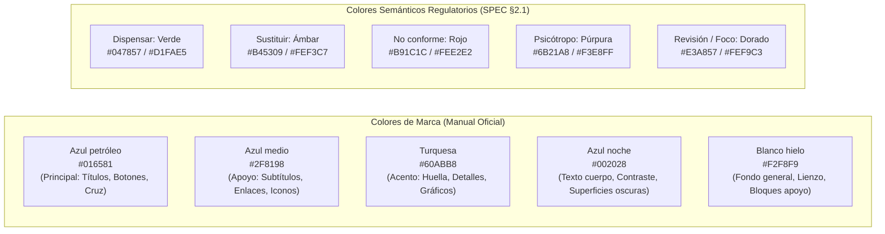

# Feature Specification: Modernización de la Interfaz de Usuario y Sistema de Diseño (UI/UX) de Mundo Mascotix

**Feature Branch**: `007-modernizacion-frontend-ui`

**Created**: 2026-11-08

**Status**: Draft

**Input**: User description: "use the specs-007 as spec document for ui modernization" — Basado en el análisis de `apps/web` y en el Manual de Identidad Visual oficial de Mundo Mascotix (logotipos, paleta de 5 colores institucionales, tipografías Bricolage Grotesque e Inter, jerarquías visuales y recomendaciones de uso).

## Clarifications

### Session 2026-11-08

- Q: ¿Cómo debe gestionarse y persistirse la preferencia entre modo claro y oscuro en la aplicación? → A: Automático por sistema con selector de 3 estados (Claro / Oscuro / Sistema), persistido en `localStorage` y conmutación fluida mediante clase `.dark` en el elemento raíz `<html>`.

---

## 1. Diagnóstico y Análisis de la Aplicación Actual

### 1.1 Estado Actual de la UI/UX y Sistema Visual
La aplicación web (`apps/web`) construida con **React 19**, **TanStack Router**, **TanStack Query** y **Tailwind CSS v4** cuenta con una base funcional sólida y alineada con los requisitos reglamentarios de la dispensación veterinaria (Real Decreto 666/2023, Reglamento UE 2019/6). Sin embargo, la interfaz actual presenta un diseño utilitario y plano que no aprovecha plenamente la riqueza del nuevo **Manual de Identidad Visual de Mundo Mascotix** ni ofrece la ergonomía óptima requerida en puestos de trabajo de alta exigencia (mostrador de dispensación con pantalla táctil, almacén y recepción de mercancía).

#### Hallazgos Clave del Análisis:
1. **Identidad Visual y Marca**:
   - **Encabezado bifurcado**: La cabecera actual fragmenta la experiencia en dos barras superpuestas (barra blanca con logotipo + barra azul con navegación y selector de usuarios), generando un consumo excesivo de espacio vertical en pantallas compactas y desaprovechando la coherencia del logotipo horizontal.
   - **Aplicación de paleta incompleta**: El color secundario *Turquesa (`#60ABB8`)* apenas se utiliza en detalles decorativos menores; el *Azul medio (`#2F8198`)* se reserva casi exclusivamente para hover o texto secundario sin un rol estructurado de jerarquía; y el *Blanco hielo (`#F2F8F9`)* actúa como fondo plano sin transiciones ni elevación cromática en tarjetas.
   - **Logotipos y márgenes de seguridad**: No se garantiza en código el margen de protección mínimo equivalente a la altura de la «M» del logotipo prescrito en el manual, ni se aprovecha de manera sistemática el **isotipo (huella con pelaje)** en espacios reducidos (cabeceras compactas móviles, botones de estado, avatares o sellos de impresión).
   - **Tipografía**: Aunque `@fontsource-variable/bricolage-grotesque` e `inter` están importadas, su uso en titulares carece de ritmo tipográfico y refinamiento en tamaños intermedios (H2, H3, subtítulos de sección y etiquetas de métricas).

2. **Ergonomía de Mostrador y Flujos Críticos**:
   - **Pantalla de Dispensación (`/recetas/$id/dispensar/$linea`)**: Es la pantalla de mayor tensión operativa. El lote recomendado por FEFO y la ubicación física en botica se muestran con peso visual similar al resto de datos. Requiere un tratamiento tipo "HUD de mostrador" con tipografía de alto impacto legible a distancia y aviso háptico/acústico contundente.
   - **Copia de Lote para TPV (`RecordatorioTpv`)**: Los empleados deben copiar el lote al TPV para el cobro en Siweb360. El botón de copia actual es básico y no proporciona feedback visual enriquecido (cambio temporal a estado de confirmación verde y microinteracción).
   - **Revisión y Visor de Receta (`VisorReceta`)**: La visualización paralela de la imagen y los campos OCR carece de sincronización interactiva (resaltar el campo de formulario al enfocar una región de la receta o viceversa) y de controles ágiles de rotación, ajuste a ancho/alto y zoom táctil fluido (pinch-to-zoom).
   - **Bandejas y Alertas Fijas (`BandaSustitucion`, `BandaPsicotropo`)**: Son fijas al scroll (`sticky`), pero su diseño visual es plano y rígido. Deben modernizarse para captar la atención sin obstruir la visualización de la prescripción.
   - **Asistente IA flotante (`asistente.tsx`)**: Funciona como un cajón lateral funcional, pero carece de estructura moderna en la presentación de tablas comparativas de medicamentos, chips interactivos de fuentes normativas (CIMAVet/Nomenclátor) y transiciones fluidas.

3. **Accesibilidad (a11y) y Estándares WCAG 2.2 AA/AAA**:
   - La combinación de *Azul noche (`#002028`)* sobre *Blanco hielo (`#F2F8F9`)* ofrece un ratio de contraste excelente (16.5:1), cumpliendo con holgura WCAG AAA.
   - El *Azul petróleo (`#016581`)* sobre blanco (6.2:1) cumple WCAG AA para textos normales y AAA para textos grandes (≥ 18pt o bold ≥ 14pt).
   - El anillo de foco actual (`:focus-visible` con Dorado `#E3A857`) es muy visible, pero debe estandarizarse con `ring-offset` armónico para no solaparse con bordes redondeados modernos.
   - Requiere `scroll-padding-top` para evitar que barras fijas oculten campos enfocados por teclado (WCAG 2.2 Focus Not Obscured).

---

## 2. Sistema de Diseño Mundo Mascotix (Design Tokens & Architecture)

### 2.1 Paleta de Color Institucional
La paleta se estructura según el Manual de Identidad Visual, respetando escrupulosamente los 5 colores corporativos y complementándolos con los colores semánticos regulatorios definidos en el SPEC:

### 2.2 Jerarquía Tipográfica y Reglas de Aplicación
1. **Títulos Principales (H1, H2 de primer nivel)**: `Bricolage Grotesque Bold` en **Azul petróleo (`#016581`)**.
2. **Subtítulos y Cabeceras de Sección (H3, H4, subtítulos de tarjetas)**: `Bricolage Grotesque SemiBold/Bold` en **Azul medio (`#2F8198`)**.
3. **Texto de Cuerpo y Formularios**: `Inter Regular` (peso 400) y `Inter Medium/SemiBold` (pesos 500/600 para etiquetas y énfasis) en **Azul noche (`#002028`)**.
4. **Detalles, Metadatos y Notas Legales**: `Inter Regular` (12–13px) en **Azul medio (`#2F8198`)** o gris azulado neutro de alto contraste.
5. **Códigos, Lotes, CNs y Números de Registro**: `JetBrains Mono` / `ui-monospace` con tracking espaciado para evitar confusiones de caracteres (ej. '0' vs 'O', '1' vs 'I').

### 2.3 Normas de Tratamiento del Logotipo
- **Fondo de Contraste**: El logotipo horizontal se aplica siempre sobre fondo blanco o Blanco hielo (`#F2F8F9`).
- **Área de Aislamiento (Clearspace)**: Margen perimetral libre obligatorio $\ge X$, donde $X$ es la altura de la letra **«M»** del logotipo.
- **Isotipo (Huella con pelaje)**: Empleado en elementos compactos: favicon, avatares de usuario, icono de aplicación PWA, encabezado colapsado en móvil y marcas de agua de seguridad en recetas verificadas.
- **Prohibiciones expresas**: Queda estrictamente prohibido deformar, aplicar sombras duras, alterar la gama cromática o aislar partes no normativas.

---

## 3. User Scenarios & Testing *(mandatory)*

### User Story 1 - Experiencia de Mostrador y Dispensación Inmersiva de Alto Rendimiento (Priority: P1)

El empleado o veterinario responsable se encuentra en el mostrador atendiendo a un cliente con una receta prescrita. La interfaz debe permitirle escanear o revisar la receta y dispensar el medicamento en menos de 10 segundos con máxima seguridad clínica y reglamentaria.

**Why this priority**: Es la pantalla central del negocio. Cualquier fricción visual, retraso o duda en la lectura del lote recomendado o la advertencia de psicótropo/sustitución impacta directamente en la atención al cliente y en el cumplimiento normativo.

**Independent Test**: Acceder a una receta en `/recetas/:id/dispensar/:linea`. La interfaz presenta el visor de la prescripción contiguo, el lote recomendado FEFO destacado en un panel de alta legibilidad, el campo de escaneo con foco reactivo automático y la banda de advertencia fija sin desbordar el viewport.

**Acceptance Scenarios**:
1. **Given** una línea evaluada con estado `DISPENSAR`, **When** se carga la pantalla de dispensación, **Then** el lote FEFO recomendado se muestra en un bloque prominente con tipografía monoespaciada en Azul petróleo, acompañado del número de unidades disponibles y la ubicación en botica.
2. **Given** un medicamento marcado como psicótropo, **When** se visualiza la pantalla de dispensación, **Then** una banda fija superior en tono púrpura (`#6B21A8` sobre `#F3E8FF`) resalta la exigencia de control de DNI del retirante y la retención física de la receta, sin bloquear la visibilidad del resto del formulario.
3. **Given** una sustitución aprobada, **When** el usuario entra a dispensar, **Then** una banda fija ámbar muestra en paralelo la comparativa entre el fármaco prescrito y el sustituto dispensado, con botón rápido para copiar el texto informativo dirigido al veterinario.
4. **Given** la confirmación exitosa de dispensación, **When** se genera el resguardo, **Then** el panel `RecordatorioTpv` resalta el lote y proporciona un botón de copia con animación de confirmación inmediata («¡Copiado al portapapeles!»).

---

### User Story 2 - Visor Dual Dinámico de Recetas y Validación OCR con Trazabilidad Visual (Priority: P1)

El personal técnico revisa una receta escaneada o fotografiada mediante el móvil. Necesita confrontar en paralelo el documento original (con zoom y navegación fluida) y el formulario estructurado con detección de campos dudosos.

**Why this priority**: Evita errores de transcripción en datos sensibles (posología, veterinario colegiado, tiempo de espera en producción o especie de destino).

**Independent Test**: Abrir `/recetas/:id/revision`. El visor de receta interactivo a la izquierda (o arriba en móviles) permite ampliar, rotar y conmutar páginas, mientras que a la derecha los bloques de formulario muestran etiquetas con tooltip interactivo y el badge de revisión en Dorado `#E3A857`.

**Acceptance Scenarios**:
1. **Given** una receta con varias páginas, **When** el usuario navega entre ellas, **Then** los selectores de página muestran miniaturas con reborde en Azul petróleo para la página activa y transición sin parpadeos.
2. **Given** un campo marcado como dudoso por la extracción (`dudosos`), **When** se visualiza el formulario, **Then** el campo muestra un borde sutil en Dorado `#E3A857`, un fondo suave y un distintivo accesible «Revisar» con foco prioritario.
3. **Given** un usuario que interactúa con la imagen de la receta, **When** acciona los controles de zoom (o hace doble clic/pellizco), **Then** la imagen responde con suavidad manteniendo el centrado del área de interés.

---

### User Story 3 - Dashboard Operativo con Identidad de Marca y Métricas Claras (Priority: P2)

El personal accede a la pantalla de inicio (`/`). La página debe transmitir orden, tranquilidad y rigor veterinario, presentando el saludo personalizado, las alertas urgentes del sistema y los accesos rápidos a las cuatro operaciones principales del negocio.

**Why this priority**: Es la puerta de entrada diaria al sistema. Organiza la carga de trabajo y previene el olvido de recetas retenidas, discrepancias con el TPV o registros pendientes.

**Independent Test**: Navegar a `/` con distintos perfiles de usuario (empleado, veterinario responsable, admin). La cabecera unificada exhibe el logotipo horizontal con el margen reglamentario, y las tarjetas de acción principal combinan iconos geométricos limpios en Azul petróleo con microinteracciones al pasar el cursor.

**Acceptance Scenarios**:
1. **Given** un usuario autenticado, **When** carga el inicio, **Then** los 4 accesos principales («Receta», «Venta sin receta», «Pedido online», «Recepción de mercancía») se presentan como tarjetas con relieve suave, icono ilustrativo y respuesta táctil activa.
2. **Given** discrepancias de TPV o sustituciones pendientes de firma, **When** el backend devuelve contadores superiores a cero, **Then** se muestran tarjetas métricas de estado con indicación numérica destacada y enlace directo a `/pendientes`.

---

### User Story 4 - Sistema de Navegación Unificada y Cabecera Compacta Responsiva (Priority: P2)

El usuario navega entre las diferentes áreas del sistema (Recepciones, Pendientes, Vademécum, Registros, Administración, Ayuda).

**Why this priority**: Resuelve la duplicidad y fragmentación de la cabecera actual, optimizando el espacio en pantalla y ofreciendo navegación fluida en escritorios y tabletas táctiles.

**Independent Test**: Modificar el tamaño de pantalla de 1440px a 768px y 375px; comprobar la transición de la barra de navegación horizontal a menú colapsable (drawer/hamburguesa) sin pérdidas de funcionalidad de autenticación ni estado de conexión.

**Acceptance Scenarios**:
1. **Given** una pantalla de escritorio (≥ 1024px), **When** se visualiza la cabecera, **Then** se integra en una única franja elegante sobre fondo Blanco hielo / blanco puro con el logotipo horizontal, enlaces de navegación con subrayado activo en Azul petróleo, indicador de usuario y botón de móvil.
2. **Given** un dispositivo móvil o tableta estrecha (< 1024px), **When** se visualiza la cabecera, **Then** se muestra el isotipo de la huella junto a «Mundo Mascotix» y un disparador de menú lateral táctil con objetivos mínimos de 44px.

---

### User Story 5 - Asistente IA Integrado con Citas Normativas y Comparador Visual (Priority: P3)

El farmacéutico o empleado activa el Asistente de Consultas para resolver dudas sobre cascada prescriptiva, alternativas de sustitución o reglas de dispensación.

**Why this priority**: Eleva la experiencia de asistencia clínica y regulatoria sin interferir en los datos locales ni suplantar la toma de decisiones del profesional.

**Independent Test**: Pulsar «Preguntar al asistente» en una línea de receta. El panel lateral se abre suavemente, manteniendo el contexto de la línea y presentando respuestas estructuradas con chips de citas oficiales (CIMAVet, Ficha técnica, RD 666/2023).

**Acceptance Scenarios**:
1. **Given** una consulta al asistente sobre sustitución equivalente, **When** el asistente responde, **Then** la comparativa se renderiza con la tabla visual estructurada `TablaComparativaCriterios` estilizada con los tokens corporativos.
2. **Given** fuentes citadas devueltas por el modelo, **When** el usuario hace clic en una fuente, **Then** se despliega una ficha emergente accesible con el extracto y el enlace a la referencia oficial.

---

### Edge Cases

- **Zoom de Navegador al 200% o 400% (WCAG Reflow)**: En aumentos extremos de zoom para baja visión, la interfaz no debe provocar desplazamiento horizontal bidireccional; los paneles divididos (side-by-side) deben apilarse automáticamente en una sola columna vertical.
- **Lote de longitud atípica o caracteres especiales**: Si un lote importado contiene más de 20 caracteres o símbolos alfanuméricos densos, el contenedor HUD de lote debe aplicar salto de línea controlado sin desbordar el contenedor ni romper la legibilidad.
- **Fallo en la API de Portapapeles (`navigator.clipboard`)**: Si el contexto del navegador bloquea el acceso al portapapeles (por ejemplo, ventana no segura o falta de foco), el botón de copia debe desplegar un fallback manual con selección de texto automática y mensaje explicativo.
- **Imágenes de recetas multipágina pesadas o de baja resolución**: El visor debe gestionar estados de carga independientes por página con placeholders esqueletizados y ofrecer un control de rotación de 90° persistente por sesión para recetas escaneadas invertidas.
- **Pérdida de foco durante cierre de modales**: Si un diálogo modal se cierra mediante la tecla `Escape`, el foco debe restituirse obligatoriamente al elemento disparador para no desorientar a usuarios de lectores de pantalla.
- **Cambio de tema en tiempo de ejecución del sistema operativo**: Si el usuario ha seleccionado el modo «Sistema» y el sistema operativo conmuta entre día y noche (o se activa el modo oscuro automático), la aplicación debe actualizar inmediatamente los estilos sin requerir recarga manual de la página ni pérdida del formulario en curso.

---

## 4. Requisitos del Sistema (Requirements) *(mandatory)*

### Functional Requirements

- **FR-001 (Tokens de Marca)**: El sistema DEBE configurar en `apps/web/src/estilos.css` los 5 colores corporativos según el manual oficial:
  - `--color-marca: #016581;` (Azul petróleo)
  - `--color-marca-apoyo: #2F8198;` (Azul medio)
  - `--color-acento: #60ABB8;` (Turquesa)
  - `--color-texto: #002028;` (Azul noche)
  - `--color-fondo: #F2F8F9;` (Blanco hielo)
- **FR-002 (Colores Semánticos de Estado)**: El sistema DEBE mantener estrictamente separados los colores corporativos de los colores de estado regulatorio:
  - Dispensar / Éxito: `#047857` sobre `#D1FAE5`
  - Sustituir / Advertencia: `#B45309` sobre `#FEF3C7`
  - No conforme / Error: `#B91C1C` sobre `#FEE2E2`
  - Pedir / Almacén: `#016581` sobre `#E0F2F7`
  - Psicótropo: `#6B21A8` sobre `#F3E8FF`
  - Revisión / Foco: `#E3A857` (Dorado de seguridad)
- **FR-003 (Regla de Accesibilidad de Color)**: NUNCA se comunicará un estado clínico o legal exclusivamente mediante color; DEBE incluirse siempre icono vectorial Lucide representativo y texto explícito legible en español.
- **FR-004 (Tipografía Oficial)**: Los títulos H1, H2 y encabezados destacados DEBEN renderizarse con `Bricolage Grotesque Variable Bold` en Azul petróleo (`#016581`). El cuerpo, tablas y campos de entrada DEBEN utilizar `Inter Variable` en Azul noche (`#002028`), con notas y subtítulos en Azul medio (`#2F8198`).
- **FR-005 (Márgenes de Seguridad del Logotipo)**: El logotipo horizontal institucional DEBE disponer siempre de un margen libre equivalente a la altura de la «M» del logotipo en todos sus lados, presentándose sobre fondo blanco o Blanco hielo (`#F2F8F9`).
- **FR-006 (Uso del Isotipo en Dispositivos Compactos)**: En anchos de pantalla inferiores a 640px o en iconos de avatar/PWA/impresión, el sistema DEBE permitir la visualización del isotipo de la huella con pelaje en sustitución del logotipo horizontal completo.
- **FR-007 (Objetivos Táctiles Ergonómicos)**: Todos los botones interactivos, casillas de verificación, opciones de desplegables y enlaces de acción DEBEN tener una altura y área táctil mínima de 44 × 44 px, de acuerdo con la norma de ergonomía de farmacia y SPEC §8.
- **FR-008 (Cabecera Unificada)**: La cabecera DEBE consolidarse en un diseño único, limpio y responsivo con logotipo normativo, navegación activa, estado de MFA, botón de vinculación móvil y selector de entorno de desarrollo (`AUTH_MODE=dev`).
- **FR-009 (Panel HUD de Dispensación)**: La pantalla de dispensación DEBE destacar el lote FEFO recomendado, su caducidad, unidades disponibles y ubicación mediante una tarjeta de alto contraste con tipografía monoespaciada de gran tamaño (≥ 28px).
- **FR-010 (Microinteracción de Copia de Lote para TPV)**: El componente `RecordatorioTpv` DEBE incorporar una animación de copia instantánea con cambio de estado visual (icono de check y texto «¡Copiado!») y compatibilidad con atajo de teclado.
- **FR-011 (Visor de Receta 2.0)**: El componente `VisorReceta` DEBE ofrecer visualización de páginas con selector de miniaturas, botones de rotación de 90°, restablecimiento de zoom (100%, ajuste de ancho, ajuste de alto) y modo de división horizontal o vertical ajustable.
- **FR-012 (Consistencia Lingüística)**: Todos los textos visibles para el usuario DEBEN redactarse en español europeo claro para personal de mostrador, sustituyendo acrónimos técnicos por denominaciones comprensibles (ej. «Código nacional» en lugar de «CN», «Número de registro» en lugar de «NReg»).
- **FR-013 (Foco No Oculto - WCAG 2.2 AA/AAA)**: Todo contenedor o página con elementos fijos/adhesivos (`Cabecera`, `BandaSustitucion`, `BandaPsicotropo`) DEBE definir `scroll-padding-top: calc(var(--altura-cabecera) + var(--altura-banda, 0px) + 16px)` para asegurar que ningún campo o botón enfocado mediante teclado quede oculto bajo las barras persistentes.
- **FR-014 (Atrapamiento y Retorno de Foco en Modales y Cajones)**: Las ventanas modales (`ModalForzado`, `TicketMultiRxModal`) y el panel lateral del asistente (`CajonAsistente`) DEBEN implementar atrapamiento de foco (`focus trap`), cierre mediante tecla `Escape`, y restitución obligatoria del foco al elemento desencadenante original al cerrarse.
- **FR-015 (Regiones Vivas Contextuales)**: Los contadores de inicio (`Inicio.tsx`) y notificaciones asíncronas de pendientes DEBEN comunicar su estado a lectores de pantalla mediante `` con frases completas de contexto (ej. «3 sustituciones pendientes de firma»), prohibiéndose dígitos numéricos aislados o múltiples regiones en competencia.
- **FR-016 (Resumen de Errores Enfocable)**: Al detectarse errores bloqueantes en la validación de una receta o dispensación, el sistema DEBE mostrar en la parte superior un contenedor con `role="alert"` y `tabindex="-1"` que reciba el foco del teclado y enlace directamente a cada campo defectuoso mediante anclas internas.
- **FR-017 (Espaciado de Objetivos Táctiles)**: Además del tamaño mínimo de 44 × 44 px, todos los controles táctiles interactivos adyacentes DEBEN mantener una separación física mínima de 8 px (`gap-2` o superior) para prevenir pulsaciones accidentales en pantallas táctiles de mostrador.
- **FR-018 (Respeto a Movimiento Reducido)**: Toda microinteracción (animación de copia de lote, transición de cajón, zoom suave) DEBE estar condicionada a `@media (prefers-reduced-motion: reduce)`, desactivando transiciones continuas para usuarios sensibles al movimiento.
- **FR-019 (Soporte Modo Claro y Oscuro con Paleta Oficial)**: El sistema DEBE implementar variantes de modo claro y modo oscuro coherentes con el manual oficial:
  - **Modo Claro (predeterminado)**: Lienzo en Blanco hielo (`#F2F8F9`), tarjetas en blanco puro, textos en Azul noche (`#002028`), titulares y botones en Azul petróleo (`#016581`).
  - **Modo Oscuro**: Lienzo en Azul noche (`#002028`), tarjetas en superficie elevada (`#002c36`), textos en Blanco hielo (`#F2F8F9`), titulares y acentos en Turquesa (`#60ABB8`) y Azul medio (`#2F8198`), y colores semánticos con contraste accesible $\ge 4.5:1$.
- **FR-020 (Selector de Tema y Persistencia)**: La cabecera DEBE incluir un selector accesible de 3 estados («Claro», «Oscuro», «Sistema») que persista la preferencia en `localStorage` (clave `mmx-tema-ui`), reaccione dinámicamente a cambios del sistema operativo mediante `matchMedia('(prefers-color-scheme: dark)')` cuando esté en modo «Sistema», y aplique la clase `.dark` en el elemento `<html>` sin parpadeo (FOUC).

### Key Entities

- **TemaVisualMundoMascotix**: Colección de tokens corporativos y semánticos inyectados mediante variables CSS en `@theme` de Tailwind v4, que gobierna colores, radios, tipografías y sombras.
- **HUDLoteRecomendado**: Entidad de presentación de datos FEFO de alta velocidad en mostrador (número de lote, fecha de caducidad, unidades, ubicación en farmacia y estado de dispensabilidad).
- **VisorDocumental**: Componente de visualización e interacción con documentos de receta (imágenes/PDFs, niveles de zoom, rotación angular, navegación por páginas y marcado visual de regiones OCR).
- **InsigniaEstadoRegulatorio**: Componente atómico compuesto (icono vectorial + texto en español + fondo cromático contrastado) que representa de forma accesible e inequívoca las decisiones del motor de validación.

---

## 5. Criterios de Aceptación y Métricas de Éxito (Success Criteria) *(mandatory)*

### Measurable Outcomes

- **SC-001 (Cumplimiento de Marca 100%)**: Todos los elementos visuales (encabezados, botones, tarjetas, fondos, enlaces y estados) aplican con precisión los códigos hexadecimales del manual oficial (#016581, #2F8198, #60ABB8, #002028, #F2F8F9).
- **SC-002 (Contraste WCAG 2.2 AA/AAA)**: El 100% de los pares texto/fondo del sistema cumplen un ratio de contraste mínimo de 4.5:1 para texto normal y 3:1 para texto grande. Los textos principales en `#002028` sobre `#F2F8F9` superan los 16:1 (AAA).
- **SC-003 (Objetivos Táctiles)**: El 100% de los elementos interactivos en pantalla de dispensación y mostrador cumplen con el tamaño táctil de al menos 44 × 44 px y espaciado $\ge 8\text{px}$.
- **SC-004 (Velocidad de Operación en Mostrador)**: El tiempo medio de confirmación de un lote escaneado y copiado al TPV se reduce en al menos un 25% gracias al nuevo panel HUD y feedback de portapapeles con microinteracción.
- **SC-005 (Preservación de Tests y No Regresiones)**: Toda la suite de pruebas unitarias y de integración de frontend (`vitest run` y `playwright`) continúa en verde sin modificaciones de contratos de API.
- **SC-006 (Contraste Verificado en Modo Oscuro y Claro)**: El 100% de los componentes y estados interactivos cumplen un ratio de contraste $\ge 4.5:1$ tanto en modo claro como en modo oscuro, sin degradación de legibilidad en el visor de receta ni en los avisos reglamentarios.

---

## 6. Assumptions

- **A-001 (Navegadores Modernos)**: Se asume que los dispositivos de mostrador y almacén ejecutan navegadores compatibles con CSS Custom Properties, CSS Grid, Flexbox y `scroll-padding-top` (Chromium $\ge 110$, Safari $\ge 16$, Firefox $\ge 115$).
- **A-002 (Emulación HID de Escáner)**: Los lectores de códigos de barras físicos en mostrador operan en modo teclado HID, enviando secuencias continuas de pulsaciones con un delimitador de retorno de carro (`Enter`).
- **A-003 (Soporte de Fuentes Web)**: Las fuentes corporativas `Bricolage Grotesque Variable` e `Inter Variable` están instaladas como paquetes npm locales (`@fontsource-variable/...`) sin requerir conexión a internet en tiempo de ejecución.
- **A-004 (Persistencia de Contratos)**: Esta modernización de UI/UX no altera los esquemas zod ni las rutas de la API backend de `apps/api`, limitándose a la presentación, ergonomía y accesibilidad en `apps/web`.
